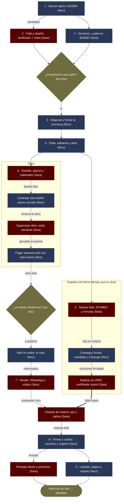

# Quién hace qué — San Marsano (roles, flujo, plan a 3 cupos y el primer millón)

> ⚠️ **Borrador de organización** (octubre de 2026). Lo legal y tributario es
> apoyo informativo, **no asesoría**: confirmar con abogado y contador.
> Versión visual: https://claude.ai/artifact/5TUY8d1rBZpB1TDVtYJGFq

**Modelo de flip (meta):** comprar en **$100M**, remodelar con **$20M**, vender en
**$170M** con pauta propia, **máximo 4 meses**.
**Meta:** pasar de 1 cupo (un flip a la vez) a **3 cupos** simultáneos.
**La regla:** cada etapa tiene **un solo responsable**. El otro ayuda, pero uno responde.

## El flujo de un flip

El ritmo lo marca **folio limpio → firmar**: aunque la obra y la venta vayan
adelantadas, la escritura no se firma sin el folio saneado y registrado.

## Los dos frentes

### Sara — diseño, papeles y cliente
- Diseña cada apto con el template San Marsano de $20M (distribución, acabados, materiales).
- **Papeles:** revisa el certificado antes de comprar, arma las minutas desde `plantillas/`,
  persigue el saneamiento (ISVIMED, notaría, ORIP) y archiva todo.
- **Mapa de los flips:** qué sigue en cada apto, quién y para cuándo (base de la reunión del lunes).
- Supervisa la obra (visita semanal + checklist). **Sin su visto bueno no se paga el avance.**
- Marca y contenido: antes/después, piezas para la pauta.
- WhatsApp: filtra con dos preguntas (¿para cuándo? ¿cómo piensa pagar?) y agenda visitas.
- Vende: **atiende sola** cada visita; Nico acompaña sin intervenir o entra con inversionistas.
- Carpeta de notaría, entrega de llaves y posventa.

### Nico — plata, compra y firma
- Consigue aptos a $100M y negocia: **adelanto y saldo el día de la escritura**.
- Consigue las firmas de vendedores y cónyuges/compañeros para los levantamientos.
- **Firma todo** como representante legal de la SAS.
- Números de cada flip y flujo de caja de todos los cupos.
- Consigue la plata (préstamos/inversionistas) y paga a tiempo.
- Contrata la obra a precio cerrado y paga cada avance que Sara aprueba.
- Cara de la marca en redes; hoja de números para inversionistas.
- Liquida cada flip con el contador: impuestos, reserva y reparto.

### Los dos — decisiones grandes
- Comprar o no (Sara: folio y diseño · Nico: números).
- Presupuesto de obra; precio de venta y piso de negociación.
- Deudas, inversionistas y gastos por encima del monto que fije la SAS.
- Reunión fija cada lunes (1 h) sobre el mapa de Sara; retro al cerrar cada flip.

## El plan para llegar a 3 cupos

| Dato | Valor |
|---|---|
| Queda por flip (después de pauta, notaría, registro) | ≈ $47M ($48M con cesión, $45M con doble escritura) |
| Fijos al mes | $5,1M ($2M de sueldo c/u + $1,1M de cuota) |
| Plata atada por cupo | **$70M** con adelanto + saldo en la escritura · **$122M** pagando todo antes |
| 3 cupos andando | **junio de 2027** con un préstamo de ~$120M en febrero |

**Tres caminos (simulación mes a mes, con colchón y reserva de impuestos):**

| Camino | Cupo 2 | Cupo 3 |
|---|---|---|
| Pagar el apto completo antes de vender, sin préstamo | 2029 | 2030 |
| Adelanto + saldo en la escritura, sin préstamo | ene 2028 | sep 2028 |
| **Adelanto + saldo en la escritura + préstamo ~$120M en febrero** | **mar 2027** | **jun 2027** |

**La estrategia, en cuatro movimientos**
1. **Que cada flip ate menos plata:** adelanto 40–50% y saldo el día de la escritura con la
   plata del comprador final (cesión, o doble escritura el mismo día).
2. **Préstamo a la SAS para el cupo 2:** ~$120M al 15% E.A. ≈ $1,4M/mes (~$5,7M por flip) vs
   ~$47M que deja cada flip. Empezar por Margarita **antes del 27-nov-2026** (renovar y
   ampliar, a nombre de la SAS). Con solo $70M, el cupo 3 se corre a jun–sep 2027.
3. **Reinvertir todo hasta tener 3 cupos:** sueldos quietos en $2M; la utilidad se queda en
   la SAS hasta junio de 2027. Con 3 cupos: ~9 ventas/año, ~$350M de utilidad antes de impuestos;
   ahí deciden si reparten o siguen abriendo cupos (ver el millón de dólares).
4. **Escalonar los cupos** (enero, marzo, junio): siempre uno comprando, uno en obra y uno vendiendo.

**Línea de tiempo (cada flip: 1 mes compra/papeles · 2 meses obra y pauta · 1 mes venta)**

| Cupo | Flips 2027 |
|---|---|
| Cupo 1 (plata propia) | Flip 3 ene–abr · Flip 5 may–ago · Flip 8 sep–dic |
| Cupo 2 (préstamo) | Flip 4 mar–jun · Flip 7 jul–oct · Flip 10 nov–feb 2028 |
| Cupo 3 (utilidades) | Flip 6 jun–sep · Flip 9 oct–ene 2028 |

**Mes a mes**
- **Oct–dic 2026 · Preparar:** cerrar 9844 y 9840; SAS + documento puente; hablar con Margarita;
  template de obra de $20M con contratista fijo; flip 3 negociado a $100M con folio revisado.
- **Ene–feb 2027 · Cupo 1 y la plata:** arranca el flip 3; Nico consigue el préstamo.
- **Mar 2027 · Cupo 2:** arranca el flip 4.
- **Jun 2027 · Cupo 3:** arranca el flip 6. Desde aquí cierra un flip casi cada mes.
- **2028 · Ritmo normal:** ~9 ventas/año; pagar el préstamo y decidir si abren un cuarto cupo.

**Reglas para que el plan no se caiga**
- Colchón de 4 meses de fijos e intereses (~$25M) que no se toca.
- Reservar el 35% de la utilidad de la SAS para el impuesto del año siguiente.
- Solo comprar lo que se sanea en el mes 1 (folio revisado por Sara antes de la promesa;
  preferir folios sin VIP o con retiro de ISVIMED ya registrado).
- Pauta desde la obra (el crédito hipotecario del comprador toma 45–90 días).
- Alarma en el mes 3: sin comprador, revisar precio entre los dos.

*Supuestos:* ~$120M libres hoy; $2M de sueldo c/u; préstamo al 15% E.A.; 35% de impuesto
reservado; colchón de 4 meses. Compra en $110M o venta en $160M → ~$37M por flip y el camino
sin préstamo se corre ~4 meses. Si los $2M son para los dos, todo se adelanta ~4 meses. Por
nómina de la SAS, cada $2M de sueldo cuesta ~$3M (deducible); con préstamo de $120M el cupo 3
sigue llegando a mitad de 2027.

## El primer millón de dólares

Con la TRM a **$3.216** (7-oct-2026), USD 1M ≈ **$3.200 millones** de **patrimonio neto** de la
SAS (caja + lo invertido en flips − deudas − impuestos). Cada flip deja ~**$25M netos**
(ya restados sueldos, cuota e impuesto) → hacen falta **~130 flips vendidos**. El tiempo depende
de cuántos flips vendan al año.

**De dónde salen los ~$25M de cada flip** (régimen de 3 cupos, 9 flips/año):

| Concepto | Valor |
|---|---|
| Venta | $170M |
| − Compra | −$100M |
| − Obra | −$20M |
| − Pauta, certificados, notaría y registro ($2M cesión / $5M doble) | −$3M |
| **= Margen del flip** | **$47M** |
| − Sueldos de los dos ($4M/mes × 12 ÷ 9 flips; los reciben ustedes) | −$5,3M |
| − Cuota ($1,1M × 12 ÷ 9) | −$1,5M |
| − Intereses del préstamo de $120M (mientras haya deuda) | −$1,9M |
| **= Utilidad antes de impuestos** | **$38,3M** |
| − Renta SAS 35% | −$13,4M |
| **= Queda en la SAS** | **≈ $25M** |

| Ritmo | Ventas/año | USD 1M (dólar a $3.216) | Dólar a $4.000 |
|---|---|---|---|
| Quedarse en 3 cupos | 9 | 2040 | 2044 |
| Crecer a 6 cupos (uno nuevo cada 3 meses desde sep-2027) | 18 | 2034 | 2036 |
| **Crecer a 10 cupos con crédito para abrirlos** (hasta mar-2029) | **30** | **sep 2032** | 2033 |

Patrimonio neto a fin de año (millones COP):

| Año | 3 cupos | 6 cupos | 10 cupos |
|---|---|---|---|
| 2027 | 165 | 164 | 164 |
| 2028 | 397 | 487 | 496 |
| 2029 | 633 | 939 | 1.174 |
| 2030 | 868 | 1.390 | 1.914 |
| 2031 | 1.103 | 1.842 | 2.655 |
| 2032 | 1.338 | 2.293 | 3.395 |
| 2033 | 1.573 | 2.745 | 4.135 |
| 2034 | 1.809 | 3.197 | 4.875 |

**Lo que pide el camino rápido**
- **Puerta antes de crecer:** abrir el cupo 4 solo si los últimos 3 flips cumplieron 4 meses y ≥ $45M.
- **Dónde comprar 30/año:** llevar el template a otras urbanizaciones (Robledo, Pajarito, Bello).
- **A quién venderle 30/año:** 2–3 compradores al mes; pauta + WhatsApp como sistema, asesoras, aliado de crédito.
- **Equipo de 8–10 personas** (modelado como +$2,5M/mes de fijos por cupo después del tercero).
- **Crédito con tope:** deuda máxima simulada ~$240M; nunca más de lo que dejan 2 trimestres de
  ventas, nunca crédito para sueldos.
- **No sacar utilidades** (solo sueldos de $2M) hasta llegar; lo que repartan antes corre la fecha.

*Sensibilidad (10 cupos):* venta $160M o compra $110M → 2034; flips de 6 meses → 2036. Sin
crédito para crecer → un año después (2033).

## A quién sumar, y en qué orden

| # | Quién | Cuándo | Con quién | Para qué |
|---|---|---|---|---|
| 1 | Contador/a | Ya | Nico | Cuenta de sueldos + SAS + dividendos antes de constituir; luego contabilidad y matrícula |
| 2 | Abogado/a de confianza | Ya | Sara | Estatutos, pacto de accionistas, documento puente; luego revisa minutas de cada flip |
| 3 | Contratista de obra fijo | Antes de enero | Contrata Nico · supervisa Sara | $20M precio cerrado por template, factura electrónica, 3 obras a la vez |
| 4 | Asistente de trámites | Con el cupo 3 | Sara | La calle: ISVIMED, notarías, ORIP, paz y salvos, citas |
| 5 | Segunda asesora comercial | Si se acumulan visitas | Sara | Por comisión, mismo guion, atiende sola |

**Aliados sin nómina:** asesor de crédito hipotecario, fotógrafo por apto, referidos en El Tirol.

## La SAS 50/50

Hoy **no hay nada firmado**: la utilidad es 50/50 y cada uno tiene sueldo, pero todo está a
nombre de Nico (promesas, poder, deuda con Margarita).

- **Ya (9844 y 9840):** documento privado entre los dos — esos flips son 50/50, qué puso cada
  uno, cómo se reparte. Figura posible: **cuenta en participación** (Art. 507 C.Co): Nico actúa
  a su nombre y rinde cuentas a Sara. Revisión del abogado.
- **2027 · SAS (Ley 1258/2008):** documento privado inscrito en Cámara de Comercio; arranca con
  plata y compra los flips nuevos a su nombre. Si se aportan inmuebles → escritura pública (art. 5).

**Estatutos + pacto de accionistas (art. 24, depositado en la sociedad, hasta 10 años):**
- [ ] Acciones 50/50.
- [ ] Nico representante legal; Sara suplente.
- [ ] Los dos aprueban compras, ventas, préstamos y gastos > $[monto].
- [ ] Desempate: última palabra por frente (Sara diseño y papeles · Nico plata y negociación); tercero que medie.
- [ ] Sueldos por nómina; utilidades 50/50 solo con 3 cupos y reserva de impuestos guardada.
- [ ] Salida: preferencia, restricción de venta a terceros (hasta 10 años, art. 13), muerte o incapacidad.
- [ ] Inversionistas como prestamistas, no accionistas.
- [ ] Marca San Marsano registrada ante la SIC a nombre de la SAS.

*La SAS paga 35% de renta + impuesto a dividendos al repartir: el contador debe compararlo con
persona natural antes de constituir.*

## Lo que falta decidir
- [ ] Monto a partir del cual deciden los dos: $[ ].
- [ ] Préstamo de febrero: con quién, cuánto (ideal $120M), tasa. Margarita antes del 27-nov.
- [ ] ¿Cesión o doble escritura el mismo día? Cesión repetida ~9 veces/año = patrón que la DIAN
      puede recaracterizar (ver `base-conocimiento-legal.md` §6); la doble cuesta ~$3M más por flip.
- [ ] El Tirol 3: la prohibición de 10 años vence abr–may 2027 (folios de 2017). Preguntar al
      abogado/ORIP si basta pedir la cancelación por vencimiento, sin retiro de ISVIMED.
- [ ] ¿La cuota de $1,1M es de un apto del negocio (costo de la SAS) o personal (sale de sueldos)?
