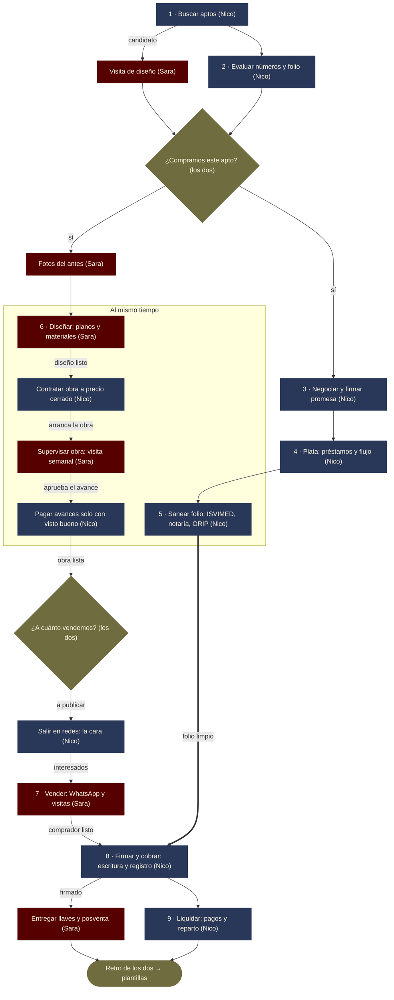

# Quién hace qué — San Marsano (roles y flujo del negocio)

> ⚠️ **Borrador de organización** (octubre de 2026). Lo legal y tributario es
> apoyo informativo, **no asesoría**: confirmar con abogado y contador.
> Versión visual: https://claude.ai/artifact/5TUY8d1rBZpB1TDVtYJGFq

**Meta 2027:** 3 o 4 flips cada tres meses (12–16 ventas al año).
**La regla:** cada etapa tiene **un solo responsable**. El otro ayuda, pero uno responde.

## El flujo de un flip

El ritmo lo marca **folio limpio → firmar**: aunque la obra y la venta vayan
adelantadas, la escritura no se firma sin el folio saneado y registrado.

## Los dos frentes

### Sara — producto y cliente ("todo lo que el comprador ve, toca y siente")
- Diseña cada apto con el template San Marsano: distribución, acabados, lista de materiales.
- Supervisa la obra (visita semanal + checklist). **Sin su visto bueno no se paga el avance.**
- Marca y contenido: fotos del antes/después, piezas para redes.
- WhatsApp: filtra con dos preguntas (¿para cuándo? ¿cómo piensa pagar?) y agenda visitas.
- Vende: **atiende sola** cada visita y negocia; Nico acompaña sin intervenir, o entra
  cuando el comprador es inversionista y pide números.
- Entrega llaves y posventa.

### Nico — plata, compra y firma ("todo lo que tiene números, contratos o firma")
- Consigue aptos y negocia con vendedores (incluidos esposos/compañeros que deben firmar).
- Números de cada flip: precio máximo de compra, presupuesto de obra, flujo de caja.
- Consigue la plata (préstamos e inversionistas) y paga a tiempo.
- Papeles: promesa, saneamiento (ISVIMED, notaría, ORIP), poder, cesión, escritura.
- Contrata la obra a precio cerrado y paga cada avance que Sara aprueba.
- Cara de la marca en redes; hoja de rentabilidad para inversionistas.
- Liquida cada flip con el contador: impuestos y reparto.

### Los dos — decisiones grandes
- Comprar o no un apto (Sara: diseño posible · Nico: números y folio).
- Presupuesto de obra (Sara diseña, Nico costea).
- Precio de venta y piso de negociación, antes de publicar.
- Cualquier deuda o inversionista nuevo.
- Reunión fija cada lunes (1 h): por apto, etapa · siguiente paso · responsable · fecha.
- Retro corta al cerrar cada flip → lo aprendido va a `plantillas/`.

## Lo que pide la meta de 2027

| Indicador | Valor | Cómo sale |
|---|---|---|
| Aptos nuevos | ≈1 al mes | 3–4 cada 3 meses |
| Aptos abiertos a la vez | 4 a 7 | ≈1–1,3 al mes × 4–5 meses de ciclo (como van 9844 y 9840) |
| Plata trabajando a la vez | $360–630M | ~$90M por apto antes de vender (adelanto $40–58M + obra ~$40M) |
| Utilidad al año (los dos) | $120–210M | 12–16 flips × $10–13M, antes de impuestos |

- **El cuello de botella es la plata.** Hoy el préstamo es de $60M (Margarita, vence
  27-nov-2026). Conseguir capital es la tarea número uno de Nico para 2027.
- Antes de nómina fija, sumar gente **por flip o por comisión** (ej.: un sueldo de $3M/mes
  con prestaciones = $36M/año ≈ utilidad de 3 flips).

## A quién sumar, y en qué orden

| # | Quién | Cuándo | Con quién | Para qué |
|---|---|---|---|---|
| 1 | Contador/a | Ya | Nico | Comerciantes por habitualidad: matrícula mercantil, contabilidad, ICA; PN vs SAS |
| 2 | Contratista de obra fijo | Antes de enero | Contrata Nico · supervisa Sara | Precio cerrado por apto según template, factura electrónica, residente para 3–4 obras |
| 3 | Abogado/a de confianza | Por operación | Nico | Revisa promesa, poder, cesión y escritura |
| 4 | Asistente de trámites | Con 3+ aptos abiertos | Nico | ISVIMED, notarías, ORIP, paz y salvos, carpetas (probable primer sueldo fijo) |
| 5 | Segunda asesora comercial | Con 3+ aptos en venta | Sara | Por comisión, mismo guion, atiende sola |

**Aliados sin nómina:** asesor de crédito hipotecario en un banco, fotógrafo por apto,
vecinos de El Tirol que refieran aptos a cambio de comisión.

## Lo que falta decidir
- [ ] **Acuerdo entre Sara y Nico** por escrito: aportes, reparto de utilidad, decisiones,
      salida. (Hoy todo está a nombre de Nico: promesas, poder y deuda de $60M.)
- [ ] **¿Persona natural o SAS?** El cálculo de `flipping-01…/escalar-5-flips…` era para 5
      flips; con 12–16 hay que rehacerlo con el contador (protección patrimonial y reparto
      entre los dos).
- [ ] **¿Seguir con la cesión?** Repetida 12–16 veces/año es el patrón que la DIAN puede
      recaracterizar (ver `base-conocimiento-legal.md` §6). A ese volumen, evaluar comprar a
      nombre propio o de la sociedad.
- [ ] **¿Quién lleva los papeles?** En este mapa quedaron en Nico; hasta hoy los venía
      llevando Sara.
- [ ] **Esquema para inversionistas** (préstamo con intereses o cuentas en participación por
      flip), con el abogado.
